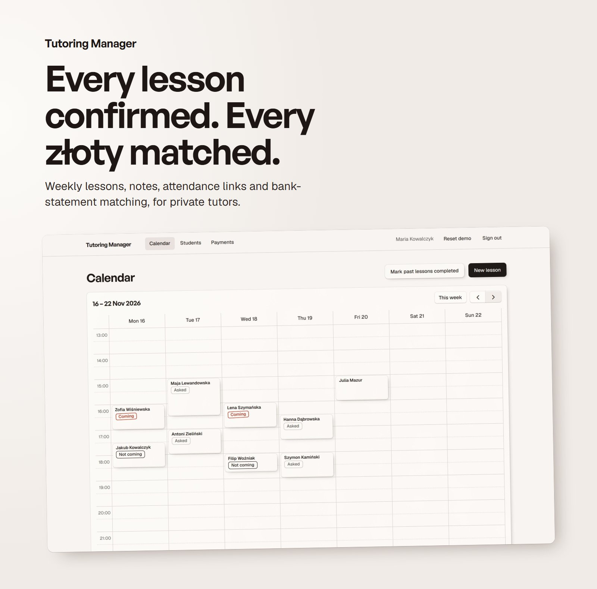
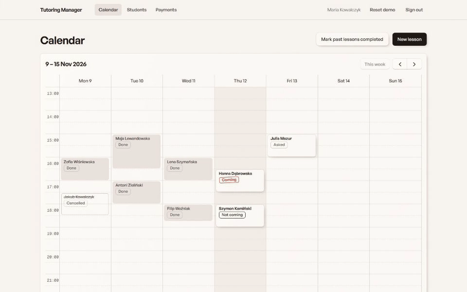
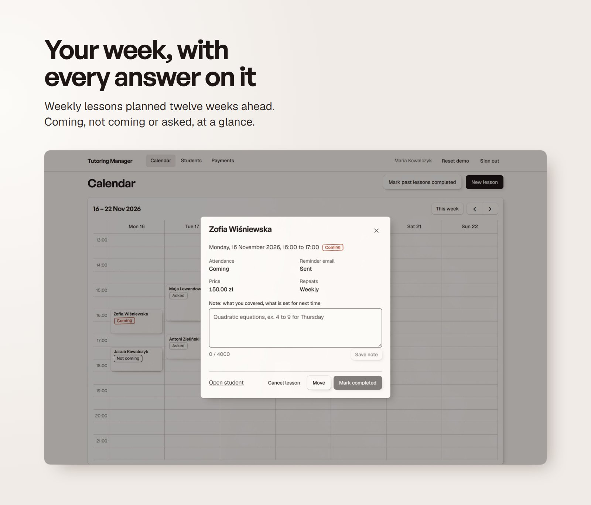
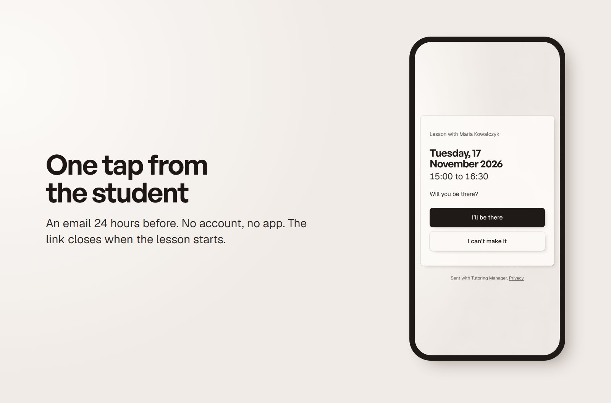
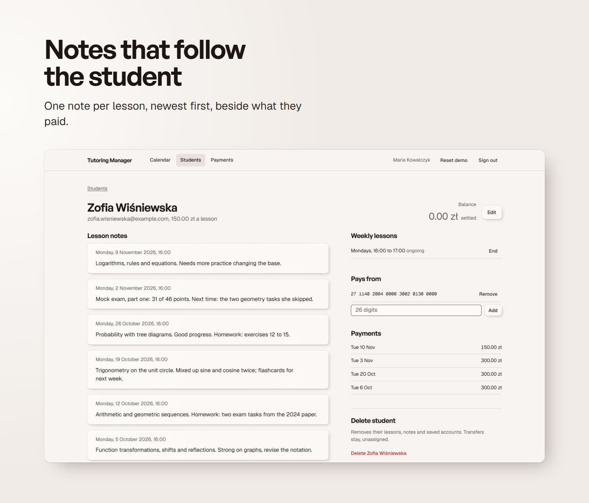
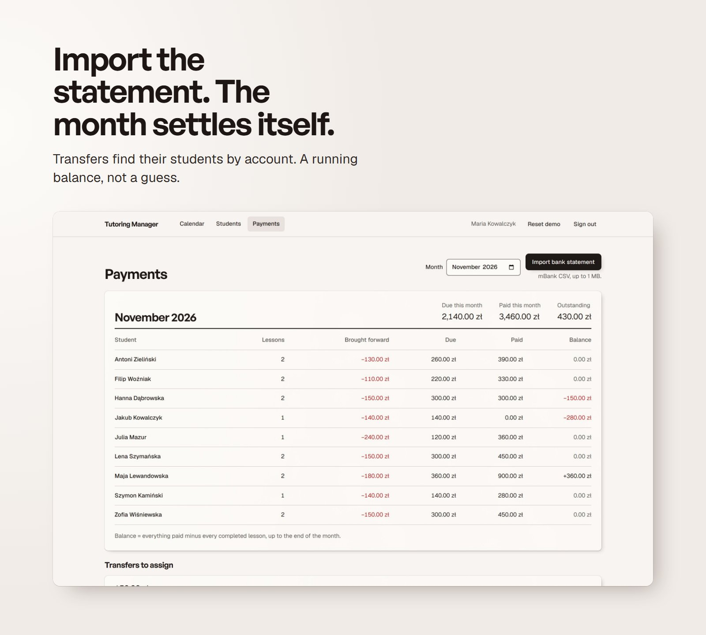
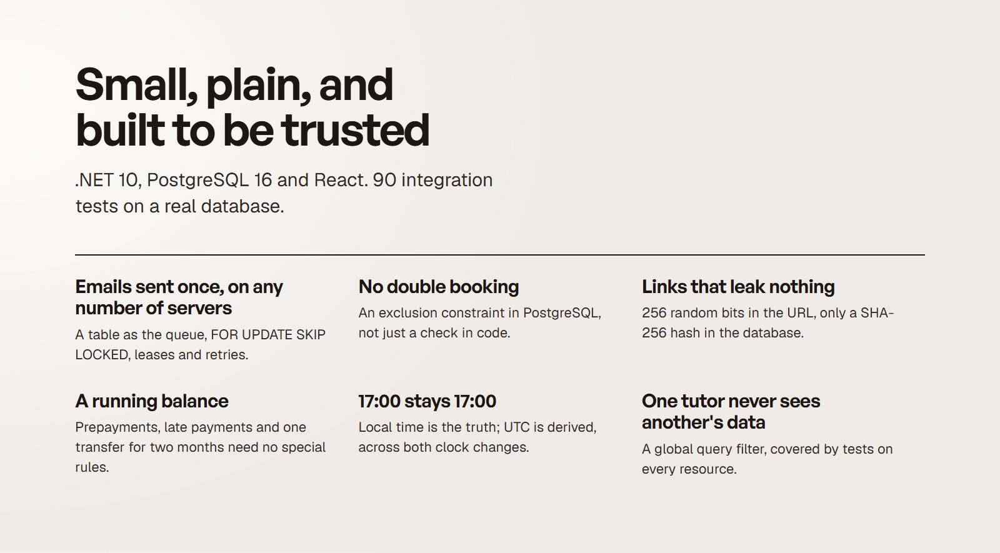
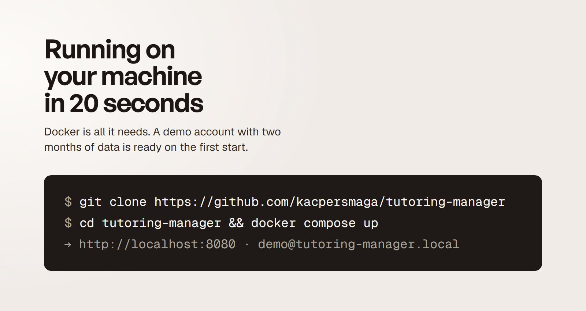

  <a href="https://github.com/kacpersmaga/tutoring-manager/releases/download/v0.1.0/tutoring-manager-demo.mp4"><b>Watch the demo film</b></a>&nbsp;&nbsp;|&nbsp;&nbsp;<a href="docs/ENGINEERING.md"><b>Engineering notes</b></a>&nbsp;&nbsp;|&nbsp;&nbsp;<a href="docs/ENGINEERING.md#run-it-in-2-minutes"><b>Run it</b></a>

  
  
  
  

