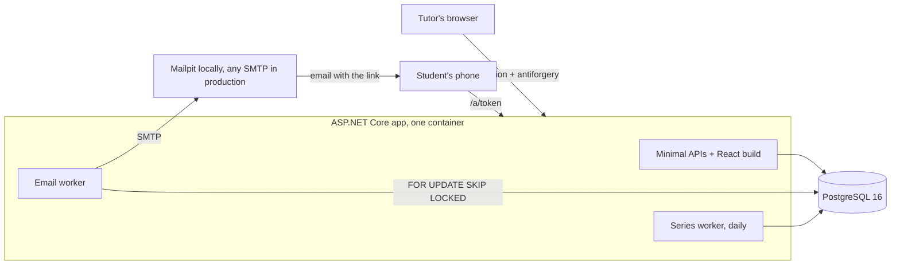

# Engineering notes

The technical side of [Tutoring Manager](../README.md): how it is built, why, and how to run, test and deploy it.

## How it works



## Engineering highlights

- **Emails on several servers, each sent once (or, after a crash, honestly twice).** The queue is a table written in the same transaction as the lesson. Workers claim batches with `FOR UPDATE SKIP LOCKED` and a 5-minute lease, retry with backoff and give up after five attempts. [Dispatcher](../src/TutoringManager.Api/Emails/EmailDispatcher.cs), [tests: parallel workers, a crashed worker's lease](../tests/TutoringManager.Tests/EmailTests.cs)
- **No double booking, guaranteed by the database.** An exclusion constraint on `tstzrange(start_utc, end_utc)` per tutor; five concurrent requests for one slot create exactly one lesson. [Migration](../src/TutoringManager.Api/Infrastructure/Migrations/20261111230213_AddLessonsAndNotes.cs), [test](../tests/TutoringManager.Tests/LessonTests.cs)
- **Attendance links that leak nothing.** 256 random bits in the URL, only the SHA-256 hash in the database, expiry at lesson start, revocation on move or cancel, `Referrer-Policy: no-referrer`. [Token](../src/TutoringManager.Api/Attendance/AttendanceToken.cs), [tests](../tests/TutoringManager.Tests/AttendanceTests.cs)
- **A running balance instead of "paid for this month?".** Prepayments, late payments, one transfer for two months and rate changes need no special rules. [Report](../src/TutoringManager.Api/Payments/ReportService.cs), [tests](../tests/TutoringManager.Tests/Payments/ReportTests.cs)
- **17:00 stays 17:00 when the clocks change.** Local time and zone are the source of truth; UTC is derived. [LessonTime](../src/TutoringManager.Api/Lessons/LessonTime.cs), [tests across 29 March and 25 October](../tests/TutoringManager.Tests/LessonTimeTests.cs)

## Design decisions

- **One API project, folders per feature** (`Auth/`, `Students/`, `Lessons/`, ...). Minimal APIs with plain services. No MediatR, CQRS, AutoMapper or repository wrappers around EF Core: at this size they add indirection without removing any complexity.
- **PostgreSQL with snake_case names** (`EFCore.NamingConventions`). Column names match PostgreSQL conventions, so the raw SQL used in a few places (exclusion constraint, email queue) reads naturally.
- **Demo data is generated relative to today** by `DemoSeeder`, only when `Demo__Enabled=true` (set in `docker-compose.yml`), so the demo never looks stale and production never gets a demo account.
- **Data protection keys live in PostgreSQL** (`PersistKeysToDbContext`), so sign-ins survive a container restart and several instances can read each other's cookies.
- **Migrations run on startup** (`Database.MigrateAsync`). Simplest option for a single instance run locally. With several instances you would run them as a separate deployment step.
- **Tests use a real PostgreSQL** (Testcontainers) instead of the in-memory provider, because key guarantees live in the database (constraints, `FOR UPDATE SKIP LOCKED`).
- **Cookie sign-in instead of JWT.** The SPA and the API share one origin, so an HttpOnly cookie is the simplest secure option: JavaScript never sees the session, and there is no refresh-token dance. The price is CSRF, handled with antiforgery tokens (see Security).
- **Tenant isolation in one place.** Every tutor-owned table has `TutorId` and a global query filter in `AppDbContext`, so a forgotten `Where` cannot leak another tutor's data. Another tutor's resources answer 404, not 403, so their existence is not revealed.
- **Expected errors as exceptions.** Services throw `ApiException` (404, 409, validation) and one `IExceptionHandler` turns it into ProblemDetails. Endpoints stay one line long and every error has the same shape.
- **Time: local time + zone is the source of truth.** A lesson stores `LocalDate`, `LocalStartTime` and `TimeZoneId`; `StartUtc`/`EndUtc` are derived on save and used for queries. "Every Tuesday at 17:00" stays at 17:00 after a daylight saving change. A time inside the spring-forward gap is moved forward, the way clocks move.
- **Recurring lessons are generated rows, not a rule evaluated on the fly.** A series creates real `Lesson` rows 12 weeks ahead and a daily worker tops it up. An exception (moved, cancelled or annotated lesson) is just an edit of that row. Editing the series replaces only future lessons that were not touched individually; each lesson remembers which series date it came from (`SeriesOccurrenceDate`), so a moved lesson never gets a duplicate. Queries stay simple and notes and attendance hang off a concrete row.
- **The database guarantees no overlapping lessons**, not just the code: an exclusion constraint `EXCLUDE USING gist (tutor_id WITH =, tstzrange(start_utc, end_utc) WITH &&) WHERE (status <> 'Cancelled')`. Two concurrent requests cannot both win. The service still checks first, so the user gets a readable 409 ("overlaps with Anna on 2027-01-20 at 17:00").
- **"Completed" is set by the tutor**, one lesson at a time or with "mark all past lessons as completed". An automatic rule would bill lessons that silently did not happen.
- **Attendance links carry a random token, the database only its hash.** 32 bytes from `RandomNumberGenerator`, Base64Url in the URL, SHA-256 in the database: a leaked database dump contains no working links. Moving or cancelling a lesson revokes its links; a link expires when the lesson starts. The page behind the link shows only the date, time and the tutor's name.
- **The email queue is a table, not a message broker.** `ScheduledEmails` rows are written in the same transaction as the lesson, so a lesson can never exist without its email (no dual-write problem). A `BackgroundService` polls every 30 s and claims a batch with `UPDATE … WHERE id IN (SELECT … FOR UPDATE SKIP LOCKED) RETURNING *`: several app instances never take the same row, and none waits for another. A claimed row is leased for 5 minutes; if the instance dies, the lease expires and another instance takes over. That makes delivery **at-least-once**: a crash after the SMTP server accepted the email but before the row was marked as sent means the student gets it twice. Exactly-once delivery over SMTP does not exist; a duplicate reminder is harmless.
- **Retries with backoff:** 1, 5, 25 and 60 minutes; after 5 attempts the email is `Failed` and the tutor sees it on the lesson.
- **When to send:** 24 hours before the lesson, or right away if the lesson is sooner. Moving a lesson cancels the pending email and queues a new one; cancelling a lesson cancels it. The attendance token is created when the email is sent, so the raw token never sits in the database.
- **Settlements as a running balance, not "has this month been paid?".** Due = completed lessons × the price stored on each lesson; paid = assigned transfers; balance = paid − due up to the end of the month. Prepayments, late payments, one transfer for two months and overpayments all fall out of the same formula without special cases. The monthly report shows opening balance, what happened in the month and the closing balance.
- **Bank statements: one parser per bank** behind `IBankStatementParser` (`CanParse`, `Parse`). The first one reads mBank's CSV export: Windows-1250 or UTF-8 (valid UTF-8 wins), semicolons, decimal commas, columns found by name. Only income is imported. A file is identified by its SHA-256, so the same file cannot be imported twice. A transfer is identified by a hash of date, amount, sender account, title and its position among identical transfers in the file, so overlapping statements do not double-count, while two genuine identical payments on one day stay two.
- **Matching by sender account.** Transfers from an account saved on a student are assigned automatically. A transfer from a parent's account is assigned by hand once, with "remember this account", and from then on matched automatically.
- **One container for API and UI.** The React app (Vite, TypeScript) is built into the API's `wwwroot` and served by ASP.NET Core, so the browser talks to one origin: the cookie stays `SameSite=Strict`, and there is no CORS to configure. In development Vite proxies `/api` to the API.
- **React without a state library.** Each screen loads what it shows with a small `useLoad` hook (loading, error, data, reload) and the URL holds filters such as the report month. FullCalendar draws the week; everything else is plain components. The visual direction is written down in [`docs/design.md`](design.md).
- **Optimistic concurrency with PostgreSQL's `xmin`**: a lesson edited in two tabs answers 409 instead of silently overwriting, without an extra version column.
- **Lesson price is copied from the student's rate** when the lesson is created, so changing the rate does not rewrite past invoices.
- **Bank accounts are stored normalized** (26 digits, no `PL`, no spaces) and checked with the IBAN mod-97 checksum, so a typo is caught when the account is entered, not when a payment fails to match.

- **The README is a product page made of images.** Slides (headline plus the real screen) are rendered from the running demo by `scripts/screenshots/readme-slides.mjs`, so they never drift from the product; the technical write-up lives here.
- **Two typefaces with separate jobs.** General Sans for headings and the wordmark, Geist for everything people read and use, with tabular numerals for money; Geist Mono only for account numbers. Chosen after a UI audit found General Sans tiring at small sizes in dense screens. See [design.md](design.md).

## Security

- **Passwords:** ASP.NET Core Identity (PBKDF2 hashing), minimum 12 characters, no composition rules (NIST SP 800-63B). Account locked for 15 minutes after 5 failed sign-ins. Unknown email and wrong password get the same answer.
- **Session cookie:** `HttpOnly`, `SameSite=Strict`, `Secure` when `Security__HttpsOnly=true` (production), 7-day sliding expiry.
- **CSRF:** every state-changing `/api` request must carry an `X-XSRF-TOKEN` header matching the antiforgery cookie (double submit). The token is bound to the signed-in user.
- **Isolation:** global query filter per tutor, covered by tests that tutor B gets 404 on tutor A's data.
- **Rate limiting** (built-in ASP.NET Core limiter, per IP): sign-in and registration 10/min, public attendance endpoints 30/min.
- **CSV import:** max 1 MB, `.csv` only, parsed into typed values (dates, decimals, digits-only account numbers); nothing from the file is executed or rendered as HTML.
- **Attendance tokens:** 256 bits of randomness, only the SHA-256 hash stored, expire at lesson start, revoked when the lesson is moved or cancelled. Malformed, unknown and revoked tokens all get the same 404.

- **HTTPS:** with `Security__HttpsOnly=true` the app redirects to HTTPS, sends HSTS and marks cookies `Secure`. Locally it runs on plain HTTP.
- **Headers:** `Content-Security-Policy` (scripts from self only, no framing, no plugins), `X-Content-Type-Options: nosniff`, `X-Frame-Options: DENY`, `Referrer-Policy: no-referrer` (the attendance token sits in the URL and must never leak in a Referer), `Permissions-Policy`.
- **Logs** carry ids and counts, never names, email addresses, tokens or note contents. Request paths (which contain attendance tokens) are not logged at the default level; SMTP failures log the exception type only.
- **Secrets** never live in the repository. The only credentials in it are the local demo account and the local database password in `docker-compose.yml`, both for a machine-local demo.
- **Dependencies:** Dependabot for NuGet, npm and GitHub Actions; NuGet audit fails the build on known vulnerabilities (warnings are errors).
- **Privacy and erasure:** a short privacy page (`/privacy`); deleting a student erases their data, deleting the account (password required) erases everything. Students may be under 18, so only a name, an email and payment accounts are stored.


## What's deliberately missing

Queues, Redis, microservices, Kubernetes, CQRS, student accounts, online payments, SMS, a mobile app. Each would add moving parts without solving a problem this product has today.

## Run it in 2 minutes

Requirements: Docker. Nothing else: the front end and the API are built inside the image.

```bash
git clone https://github.com/kacpersmaga/tutoring-manager.git
cd tutoring-manager
docker compose up --build
```

Measured from `git clone` to a healthy app: **20 seconds** with a cold build (`--no-cache`) on a desktop machine whose Docker already had the base images. The first ever run also pulls the .NET, Node and PostgreSQL base images (about 1 GB), which depends on your connection.

The first start creates the database and a demo account with two months of realistic data. The console prints the address, the demo login and the Mailpit address. On the sign-in page, **Open the demo account** signs you straight in; **Reset demo** in the top bar puts the data back to its starting state, dated from today.

| What | Where |
| --- | --- |
| App | http://localhost:8080 |
| Demo account | `demo@tutoring-manager.local` / `demo-password-2027` (local demo mode only) |
| Mailpit (all outgoing email, including attendance links) | http://localhost:8025 |
| Health check | http://localhost:8080/health |

## Tests

Requirements: .NET 10 SDK and Docker (integration tests start a real PostgreSQL with Testcontainers).

```bash
dotnet test
```

### Screenshots, GIF and film

Everything visual in this README is generated from the running demo, so it can be refreshed after any UI change:

```bash
cd scripts/screenshots && npm install && npx playwright install chromium
npm run screenshots        # docs/images/*.jpg and the landing page's product shots
node social-images.mjs     # Open Graph image and the repository's social preview
node readme-slides.mjs     # the README slides in docs/readme
node audit.mjs             # UI audit: contrast, touch targets, labels, overflow at desktop and phone width
npm run record             # flow clips for the film (needs a fresh demo: docker compose down -v && docker compose up)
cd ../../video && npm install
npx remotion render DemoFilm out/tutoring-manager-demo.mp4
npx remotion render ReadmeGif out/demo.gif --codec=gif
```

## Deployment

The project is not hosted; it runs locally with one command. To run it in production, build the same image and set:

| Variable | Purpose |
| --- | --- |
| `ConnectionStrings__Default` | PostgreSQL 16 connection string |
| `Email__SmtpHost`, `Email__SmtpPort`, `Email__SmtpUseStartTls`, `Email__SmtpUsername`, `Email__SmtpPassword` | any SMTP server or transactional email provider |
| `Email__FromAddress`, `Email__FromName` | the sender of attendance emails |
| `Email__PublicBaseUrl` | the public address, used in attendance links |
| `Security__HttpsOnly=true` | HTTPS redirect, HSTS, `Secure` cookies |
| `Demo__Enabled` | leave unset (false) |

Put TLS in front (a reverse proxy or the platform's ingress). Migrations run on startup, which suits one instance; with several, run them as a release step. The email worker is already safe to run on several instances.

## Roadmap

Late-cancellation fee, SMS reminders, student accounts, online payments, more banks, PDF export, a queue once there are thousands of emails per minute or other systems reacting to events.
